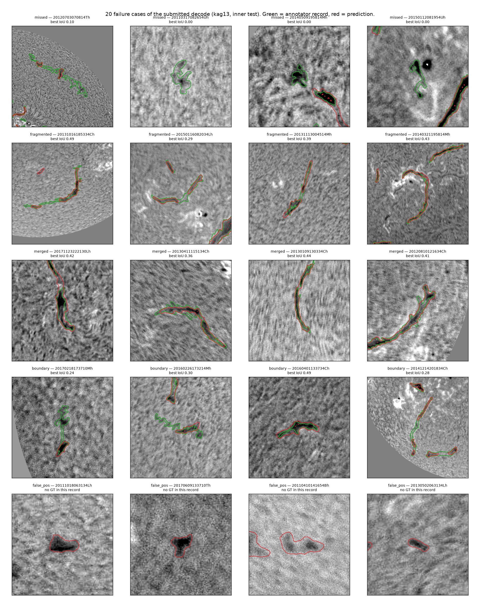

# Step 2 — diagnosis of the submitted pipeline

_Tables generated by `kaggle/try_error/diagnose.py`; the reading below the marker is hand-written._

Local validation: 707 inner-test disks of `kaggle/splits/folds_k707_v1.json` (5 folds, grouped by 7-day observation window), 1154 annotator records, official self-evaluation rule.

| PQ | SQ | RQ (detection F1) | TP / FP / FN | Dice, matched pairs | Dice, overlapping pairs | pixel Dice per record | one-to-many | many-to-one |
|---|---|---|---|---|---|---|---|---|
| **0.3943** | 0.665 | 0.593 | 4858/3322/3341 | 0.796 | 0.689 | 0.648 | 527 | 118 |

## Failure classes (per annotator record)

| class | count | share of FN / FP | PQ if this class were repaired | gain |
|---|---|---|---|---|
| missed (GT without a hit) | 1762 | 52.7% of FN | 0.4851 | +0.0908 |
| fragmented (GT without a hit) | 242 | 7.2% of FN | 0.4160 | +0.0217 |
| merged (GT without a hit) | 155 | 4.6% of FN | 0.4082 | +0.0139 |
| boundary (GT without a hit) | 1182 | 35.4% of FN | 0.5025 | +0.1082 |
| false positive (prediction on no GT) | 1210 | 36.4% of FP | 0.4257 | +0.0315 |
| partner (prediction on a GT it does not hit) | 2112 | 63.6% of FP | — | — |

## Numbers behind the RQ-vs-SQ call

- Hits: IoU quantiles 10/50/90 % = 0.55 / 0.67 / 0.78; 25% of hits sit between 0.5 and 0.6.
- FN whose best prediction has IoU in (0.4, 0.5]: 728 (21.8% of FN).
- Boundary failures (1182): partner area / GT area 10/50/90 % = 0.31 / 0.72 / 2.41; share of the partner inside the GT 0.39 / 0.68 / 0.92; share of the GT covered 0.26 / 0.52 / 0.99.
- Missed filaments (1762): GT area 10/50/90 % = 267 / 648 / 2278 px; 28% are smaller than the 400 px seed minimum.
- Pure false positives (1210): area 10/50/90 % = 478 / 822 / 2380 px; mean probability 0.84 / 0.90 / 0.94.
- PQ = SQ x RQ = 0.665 x 0.593. With every instance detected (RQ = 1) PQ would be 0.665; with perfect masks on today's hits (SQ = 1) it would be 0.593.

## Failure panel

| # | class | disk | record | detail |
|---|---|---|---|---|
| 1 | missed | 20120703070814Th | 010402 | cov 0.16, best_iou 0.10 |
| 2 | missed | 20110317082654Uh | 030101 | cov 0.00, best_iou 0.00 |
| 3 | missed | 20140509195814Mh | 010101 | cov 0.00, best_iou 0.00 |
| 4 | missed | 20150112081954Uh | 010101 | cov 0.00, best_iou 0.00 |
| 5 | fragmented | 20131016185334Ch | 010101 | cov 0.65, best_iou 0.49, n_frag 2 |
| 6 | fragmented | 20150116082034Lh | 050101 | cov 0.56, best_iou 0.29, n_frag 2 |
| 7 | fragmented | 20131113004514Mh | 040301 | cov 0.84, best_iou 0.39, n_frag 2 |
| 8 | fragmented | 20140321195814Mh | 010102 | cov 0.82, best_iou 0.43, n_frag 2 |
| 9 | merged | 20171123222130Lh | 050101 | cov 0.89, best_iou 0.42, n_merged 2 |
| 10 | merged | 20130411115134Ch | 060403 | cov 0.55, best_iou 0.36, n_merged 2 |
| 11 | merged | 20130109130334Ch | 040301 | cov 0.92, best_iou 0.44, n_merged 2 |
| 12 | merged | 20120810121634Ch | 050101 | cov 0.83, best_iou 0.41, n_merged 2 |
| 13 | boundary | 20170218173710Mh | 010101 | cov 0.26, best_iou 0.24, pred_over_gt 0.36 |
| 14 | boundary | 20160226173214Mh | 010101 | cov 0.36, best_iou 0.30, pred_over_gt 0.59 |
| 15 | boundary | 20160401133734Ch | 010301 | cov 1.00, best_iou 0.49, pred_over_gt 2.03 |
| 16 | boundary | 20141214201834Ch | 050102 | cov 0.47, best_iou 0.28, pred_over_gt 0.33 |
| 17 | false_pos | 20111018063134Lh | 020403 |  |
| 18 | false_pos | 20170609133710Th | 050101 |  |
| 19 | false_pos | 20110410141654Bh | 010403 |  |
| 20 | false_pos | 20130502063134Lh | 040301 |  |

## Reading (hand-written)

**The loss is mainly in RQ (detection), not SQ (mask quality of the hits).**

- SQ is 0.665 and cannot move much: a hit needs IoU > 0.5 by definition, the median hit is 0.67, and two human
  annotators reach only 0.634 on their own matched pairs (`kaggle/docs/05_annotator_pq.md`). The masks we do
  match are already drawn as well as a second expert draws them.
- RQ is 0.593: of 8,199 GT filaments (pooled over records) 3,341 have no hit, and 3,322 predictions hit nothing.
  Every repair in the table above works through TP/FP/FN, i.e. through RQ.
- But "detection" here is mostly **extent**, not presence. Only 53 % of the FN are filaments the model did not
  find at all. The other 47 % (1,579) were found and lost at the IoU 0.5 bar: 1,182 boundary cases (the
  prediction is typically shorter than the annotation: median partner area 0.72 x GT, median GT coverage 0.52),
  242 fragmented, 155 merged. 728 FN (22 %) have a prediction with IoU between 0.4 and 0.5. Each of these
  costs twice: one FN and one FP (64 % of all FP are such partners).
- Pure false positives (1,210, 36 % of FP) are confident (median mean-probability 0.90) dark blobs; in the panel
  (row 5) they look like real small filaments that this annotator did not outline. A stricter global filter
  cannot separate them (the decode search already showed that); only per-object evidence might.
- Missed filaments: 28 % are below the 400 px seed minimum, the rest are faint (row 1 of the panel).

**What this says about the ideas.** The largest repairable block is boundary + fragmented + merged
(oracle +0.108 / +0.022 / +0.014): the right object at the wrong level of the probability map. One global
threshold cannot fix it, because a lower level lengthens short predictions but merges neighbours and a higher
level does the reverse; the decode search confirmed the global surface is flat (0.3943 is 12th of 4,992 cells,
best 0.3955) while the per-image oracle is 0.4724. So the first idea to test is choosing the level **per
object** (component tree + a learned score), which covers threshold choice, small-island removal, splitting
and merging in one rule. Gap bridging along the axis addresses only the 242 fragmented cases and was already
measured on the 958 set (+0.003, closed). Test-time augmentation and model averaging act on the probability
map itself (missed + boundary) and come next.

Caveat on the classes: they are computed per annotator record, so a prediction counted as a false positive
against one record can be a hit against another record of the same disk; "merged" includes cases where the
annotator split one dark structure into two outlines (panel #11, #12), which no image evidence can predict.
